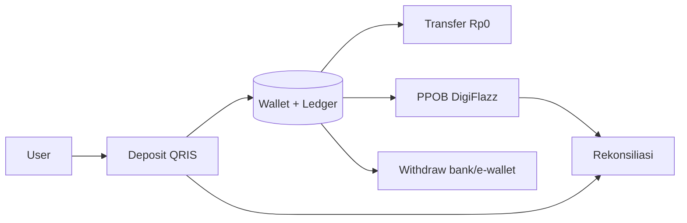

<div align="center">

# 💳 FanzPay

### Dompet Digital & PPOB Indonesia

**Simple interface, sophisticated system — deposit QRIS real-time, transfer gratis, dan 8 layanan dalam satu saldo.**


*Platform PPOB + dompet digital: deposit via QRIS, transfer **gratis** antar pengguna, withdrawal ke bank & e-wallet, dan pembelian produk digital — dengan ledger append-only, webhook terverifikasi, dan idempotency di semua alur finansial.*

</div>

---

## ✨ Kenapa FanzPay?

| Fitur | Detail |
|---|---|
| ⚡ **Deposit QRIS real-time** | QR dibuat via BuatQris, saldo masuk otomatis setelah webhook terverifikasi HMAC-SHA256 |
| 💸 **Transfer gratis Rp0** | Antar pengguna via nomor HP atau scan QR — atomic, tanpa payment gateway |
| 🏧 **Withdrawal bank & e-wallet** | Lock saldo → request provider → webhook approve/reject → rollback aman bila gagal |
| 🛍️ **Katalog PPOB real** | Pulsa, data, PLN, e-money, game, TV, PDAM, BPJS — 100% dari DigiFlazz, tanpa hard-code |
| 🔐 **Keamanan berlapis** | PIN 6 digit terpisah dari password, OTP email, rate limit, CSRF, audit log |
| 📊 **Command Center** | Dashboard super admin: volume, revenue, provider balance, rekonsiliasi, laporan |

> Prinsip: **"Simple interface, sophisticated system."** — mobile terasa seperti aplikasi Android modern, desktop seperti dashboard fintech premium.

---

## 🏗️ Arsitektur

```
fanzpay/
├── web/                  ← APLIKASI WEB (PHP native + MySQL, siap XAMPP & cPanel)
│   ├── index.php         ← front controller (web + /api/* + /webhooks/*)
│   ├── app/Core/         ← DB, Auth+RBAC, CSRF, Validator, RateLimiter, Router, View, Logger
│   ├── app/Services/     ← Wallet, Deposit, Withdraw, Transfer, Ppob, Pricing, Pin, Otp, …
│   ├── app/Providers/    ← BuatQrisClient, DigiFlazzClient, MockProvider
│   ├── views/            ← layout public/auth/app/admin + 35 halaman
│   └── public/assets/    ← css/app.css + js/app.js (tanpa build step)
├── android/              ← APLIKASI ANDROID (Kotlin + Compose + Retrofit)
├── docs/                 ← API contract, deployment, keputusan teknis
└── prompt/               ← brief & arsip Open API (arsip)
```

**Keputusan teknis inti** (selengkapnya di [`docs/keputusan-teknis.md`](docs/keputusan-teknis.md)):

- 🗄️ **PHP native tanpa framework** — deploy cPanel shared hosting tanpa SSH/composer.
- 💰 **Nominal = INT rupiah** — tanpa float; satu-satunya penulis saldo adalah `WalletService::append` (`SELECT … FOR UPDATE` + ledger append-only).
- 🔁 **Idempotency dua lapis** — `X-Idempotency-Key` aplikasi + unique constraint DB.
- 🔑 **PIN ≠ password** — tabel & hash terpisah, throttling + lockout sendiri.
- 🧩 **Provider terisolasi** — hanya `BuatQrisClient`/`DigiFlazzClient` yang tahu endpoint & signature; kredensial tidak pernah ke frontend/APK.
- 🚫 **Nol data demo** — tanpa akun/produk bawaan; semua data 100% real.

---

## 🚀 Mulai Cepat (XAMPP)

**Syarat:** XAMPP (Apache + MySQL + PHP ≥ 8.1 dengan `pdo_mysql`, `curl`, `mbstring`, `openssl`).

```powershell
# 1. Pastikan Apache & MySQL berjalan (XAMPP Control Panel)

# 2. Salin environment
copy web\.env.example web\.env

# 3. Install database (idempotent, aman diulang)
D:\xampp\php\php.exe web\install.php

# 4. Buka di browser
http://localhost/fanzpay/web/
```

**Buat super admin pertama** (tidak ada akun bawaan):

```powershell
D:\xampp\php\php.exe web\create-admin.php "Nama Anda" anda@email.com 0812xxxxxxx "PasswordMin8"
```

**Tarik katalog real DigiFlazz:**

```powershell
D:\xampp\php\php.exe web\sync.php
# atau via panel: Admin → Produk → Sinkron sekarang
```

**Jalankan test:**

```powershell
D:\xampp\php\php.exe web\tests\run.php
```

---

## 📱 Aplikasi Android

Native **Kotlin + Jetpack Compose (Material3) + Retrofit + DataStore + CameraX/ML Kit**, mengonsumsi `web/api/*` yang sama.

| Kebutuhan | Detail |
|---|---|
| Emulator | `API_BASE_URL` default `http://10.0.2.2/fanzpay/web/` → Run ▶ |
| HP fisik | Isi field **Server** di layar Login, mis. `http://192.168.1.10/fanzpay/web/` |
| Production | Wajib HTTPS (`usesCleartextTraffic=false`) |

Fitur: login, beranda + saldo, produk + beli (PIN), transfer (resolve nama + scan QR), deposit + polling status, withdraw, riwayat, notifikasi, QR saya (offline), scan QR (`fanzpay://pay/u/{id}`). Detail: [`android/README.md`](android/README.md).

> Kredensial provider **tidak ada** di APK — semua request provider lewat backend. Yang disimpan di HP hanya Bearer token sesi.

---

## 🔄 Alur Uang (ringkas)



- Setiap perubahan saldo: `transaction ID`, `reference ID`, saldo sebelum/sesudah, status, timestamp, metadata, dan referensi provider.
- Webhook ganda? Transaksi hanya diproses **satu kali**.
- Transfer Rp80.000 yang dikirim dua kali bersamaan? Saldo hanya berkurang **Rp80.000**.

---

## 🔐 Keamanan

PDO prepared statement · CSRF semua form · session regenerate + expiry 12 jam · `password_hash` · PIN 6 digit ter-hash + lockout 15 menit setelah 5× salah · rate limit login/PIN/API · webhook HMAC wajib · idempotency key · ledger append-only + row locking · audit log semua aksi sensitif · security header · log bebas rahasia (auto-redact).

> Yang **tidak** diklaim: "tidak bisa diretas" — targetnya meminimalkan surface, mencegah serangan umum, mendeteksi, dan menjaga auditabilitas.

---

## 📚 Dokumentasi

| Dokumen | Isi |
|---|---|
| [`docs/api-contract.md`](docs/api-contract.md) | Kontrak endpoint `web/api/*` untuk frontend & Android |
| [`docs/deployment-cpanel.md`](docs/deployment-cpanel.md) | Deploy production langkah-per-langkah (tanpa Docker/Node) |
| [`docs/keputusan-teknis.md`](docs/keputusan-teknis.md) | 16 ADR: kenapa PHP native, INT rupiah, PIN terpisah, dsb. |

**Cron (rekonsiliasi & deposit kedaluwarsa)** — cPanel → Cron Jobs, tiap 5 menit:

```bash
php /home/username/public_html/cron/reconcile.php
```

---

## 🗺️ Roadmap

- [x] Auth + RBAC (super_admin, admin, user) + OTP email
- [x] Wallet + ledger + deposit QRIS + webhook
- [x] Transfer gratis + QR user + withdrawal
- [x] Katalog DigiFlazz + pricing engine + PPOB
- [x] Command Center + rekonsiliasi + audit log
- [x] Aplikasi Android native
- [ ] Notifikasi push (FCM)
- [ ] Laporan keuangan ekspor (CSV/XLSX)

---

## 🤝 Kontribusi

1. Fork repository ini
2. Buat branch fitur: `git checkout -b feature/nama-fitur`
3. Ikuti gaya kode yang ada (PHP PSR-12, komentar Indonesia yang sopan, tanpa emoji sebagai ikon UI)
4. Pastikan `php web/tests/run.php` tetap hijau
5. Buat Pull Request dengan deskripsi yang jelas

---

## 📄 Lisensi

MIT — lihat file `LICENSE` (bila belum ada, kode ini bebas dipakai dengan atribusi).

---

<div align="center">

**Dibuat dengan prinsip fintech yang serius: uang dulu yang benar, baru UI yang indah.** 💙

*© 2026 FanzPay — Dompet Digital & PPOB Indonesia.*

</div>
